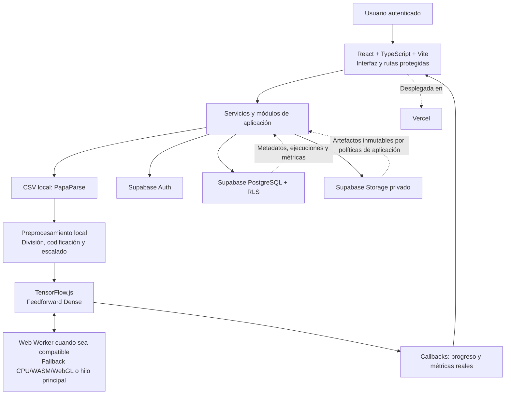
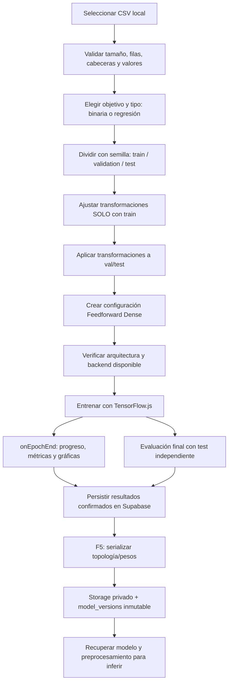

# NeuroLab Enterprise — Documento de diseño aprobado (Fase 0)

> **Estado:** APROBADO — Fase 0 cerrada  
> **Fecha de aprobación:** 7 de noviembre de 2026  
> **Versión del documento:** 1.0  
> **Próxima fase:** Fase 1 — Base: React, Supabase Auth, rutas protegidas y despliegue en Vercel. **No iniciada.**  
> **Fuente curricular y funcional:** *Documento Maestro de Desarrollo — Plataforma Enterprise de Redes Neuronales Artificiales*, versión 1.0, octubre de 2026, 9 páginas.  
> **Regla de prevalencia:** ante cualquier contradicción, prevalecen las decisiones expresas aprobadas para este proyecto sobre el Documento Maestro.

## Control de decisiones

| Hito | Resultado |
|---|---|
| Entrega 1 | **Aprobada**: arquitectura, estructura de carpetas y modelo lógico de Supabase. |
| Entrega 2 | **Aprobada**: matriz de permisos, RLS, flujo de ML, riesgos, criterios de aceptación y matriz de trazabilidad. |
| Confirmación específica de seguridad | **Aprobada**: el Administrador global gestiona usuarios, privilegios, proyectos y configuración, **pero no accede automáticamente al contenido técnico privado** de los proyectos ni puede entrenar o aprobar modelos sin un rol de proyecto autorizado. |
| Alcance del cierre | Documentación. **Sin generación de código fuente, componentes, SQL, migraciones o despliegues.** |

### Convenciones de trazabilidad

- **PDF**: requisito procedente del Documento Maestro. Se citan capítulo y página; el PDF es el documento de referencia original.
- **Adaptación aprobada**: cambio decidido para NeuroLab Enterprise en las dos entregas y sus instrucciones de alcance.
- **Propuesta pendiente de validación técnica**: parámetro o versión que requiere pruebas antes de convertirse en una configuración definitiva.
- **Mantiene / Adapta / Pospone**: estado respecto del PDF, no indicador de que la funcionalidad ya esté implementada.

---

# Parte I — Entrega 1: arquitectura, organización y datos

## 1. Propósito y alcance

NeuroLab Enterprise permitirá a usuarios autorizados crear proyectos de redes neuronales, diseñar arquitecturas, preparar datasets, entrenar, evaluar, consultar métricas y registrar versiones con trazabilidad. Es un **proyecto nuevo desde cero**: no se reutilizan código, migraciones, tablas ni decisiones de implementaciones anteriores.

El objetivo curricular de la Semana 11 consiste en comprender la red neuronal, describir neuronas/capas/conexiones, identificar familias Feedforward, RNN, CNN y GAN y crear una red neuronal. **PDF:** capítulos 2–3 (p. 2). Se mantiene el propósito y se **adapta** la tecnología: se usa TensorFlow.js en lugar de Python y TensorFlow/Keras de servidor.

### 1.1 Decisiones de alcance que prevalecen sobre el PDF

1. El entrenamiento y la inferencia se realizan en el **navegador con TensorFlow.js**; no hay infraestructura remota de entrenamiento.
2. Se usarán callbacks reales (`onEpochEnd`) y mensajes locales del Web Worker para progreso y métricas. No se usarán colas remotas, SSE ni WebSocket para el entrenamiento.
3. **PapaParse** leerá CSV locales. No se subirán CSV completos: Supabase conservará **solo metadatos, parámetros de preparación y referencias**.
4. El CSV tendrá un límite inicial propuesto de **10 MiB y 50 000 filas** (se rechaza al superar cualquiera de los límites). Se comprobarán también dimensiones transformadas y consumo de memoria.
5. Se dividirán datos con semilla reproducible en entrenamiento, validación y prueba; los transformadores se ajustarán solo con el subconjunto de entrenamiento para impedir fuga de datos.
6. Se intentará usar Web Worker cuando sea compatible. La elección de WebGL, WASM o CPU se validará con entrenamiento real, con respaldo al hilo principal y aviso cuando corresponda.
7. **Vercel + Supabase** constituyen la infraestructura gratuita inicial. Una Edge Function solo se considerará si una operación administrativa requiere privilegios de servidor.
8. El primer alcance entrenable será **Feedforward Dense**, para **clasificación binaria y regresión**; RNN, CNN y GAN quedan documentadas y pospuestas.
9. Se aplicará Supabase Auth **exclusivamente con correo y contraseña**. No habrá registro público ni OAuth.
10. PostgreSQL será fuente de verdad; Storage privado contendrá artefactos de modelos versionados; RLS hará cumplir los permisos.

## 2. Arquitectura lógica aprobada



> **Interpretación:** el navegador calcula; Supabase autentica, autoriza y persiste. Ninguna API propia recibe CSV para entrenar. El Web Worker es un Worker **del navegador**, no un trabajador de servidor.

### 2.1 Responsabilidades por componente

| Componente | Responsabilidad | Introducción prevista |
|---|---|---|
| React + TypeScript | Interfaces, navegación, formularios, estado visual, errores y accesibilidad. | F1 |
| Vite | Desarrollo, compilación y empaquetado de la SPA. | F1 |
| React Router | Login obligatorio, navegación y protección de rutas. | F1 |
| Supabase Auth | Sesión, inicio/cierre, contraseña y usuarios administrados. | F1 |
| Supabase PostgreSQL | Proyectos, membresías, arquitecturas, metadatos de datasets, ejecuciones, métricas, modelos y auditoría. | F1–F6 |
| Row Level Security (RLS) | Aislamiento por identidad, estado del usuario y pertenencia/rol del proyecto. | Desde F1 |
| Supabase Storage privado | Topología y pesos de modelos por versión, con acceso autorizado. | F5 |
| PapaParse | Lectura y validación de CSV en cliente. | F3 |
| Motor de preprocesamiento | Partición, imputación, codificación, escalado y manifiesto reproducible. | F3 |
| TensorFlow.js | Construcción, entrenamiento, evaluación, predicción y serialización. | F3–F5 |
| Web Workers | Cálculo fuera del hilo principal cuando sea viable; progreso, cancelación y errores. | F3 |
| Recharts | Gráficas de pérdida, métricas por época e historial. | F4 |
| Tailwind CSS | Diseño responsive y temas claro predeterminado / oscuro en escala de grises. | Según necesidad; base desde F1 |
| Lucide React | Iconografía coherente. | Según necesidad |
| Vercel | Hospedaje y despliegue de la SPA, con variables de entorno documentadas. | F1 |
| Edge Functions | Operaciones administrativas privilegiadas cuando se justifique; **nunca** entrenamiento. | F6 si se requieren |

**Fuera del alcance de esta arquitectura:** FastAPI, Python, TensorFlow/Keras de servidor, Render, colas remotas, Docker de entrenamiento, SSE/WebSocket para métricas de entrenamiento y duplicación de modos navegador/servidor. **PDF adaptado:** capítulo 5 (p. 3), capítulo 9 (pp. 5–6) y capítulo 13 (p. 7).

### 2.2 Separación de responsabilidades

- `features/` implementará cada funcionalidad y su interacción con React.
- `ml/` contendrá la lógica matemática y de datos, independiente de la vista.
- `workers/` orquestará trabajo pesado local y mensajes tipados, sin conocer las pantallas.
- `lib/` centralizará el cliente público de Supabase; las comprobaciones de seguridad efectivas quedarán en RLS, privilegios SQL y operaciones protegidas.
- `components/ui/` alojará componentes compartidos **cuando un caso de uso los requiera**: tarjetas, modales, formularios, notificaciones, tablas paginadas, spinners y estados vacíos.
- Se mantendrán comentarios útiles, TypeScript estricto, errores explícitos, pruebas incrementales y una sola interfaz por módulo.

## 3. Organización recomendada del repositorio

Estructura **objetivo**, no estructura que deba materializarse íntegramente en F1:

```text
neurolab-enterprise/
├── public/                      # Recursos estáticos
├── src/
│   ├── app/                     # Router, providers y configuración
│   ├── components/
│   │   ├── ui/                  # Componentes compartidos, progresivamente
│   │   └── layout/              # Shell y navegación
│   ├── features/
│   │   ├── auth/                # Fase 1
│   │   ├── projects/            # Fase 2
│   │   ├── architectures/       # Fase 3
│   │   ├── datasets/            # Fase 3
│   │   ├── training/            # Fase 3
│   │   ├── evaluation/          # Fase 4
│   │   ├── models/              # Fase 5
│   │   ├── reports/             # Fase 6
│   │   └── administration/      # Fase 6
│   ├── ml/
│   │   ├── preprocessing/       # Transformaciones y división reproducible
│   │   ├── networks/            # Construcción y validación de Dense
│   │   └── persistence/         # Serialización y carga de modelos
│   ├── workers/                 # Web Workers del navegador
│   ├── lib/                     # Supabase y utilidades
│   ├── hooks/                   # Hooks reutilizables
│   ├── types/                   # Tipos compartidos
│   └── styles/                  # Tailwind, variables y temas
├── supabase/
│   ├── migrations/              # Migraciones versionadas por fase
│   ├── tests/                   # Pruebas de RLS y datos
│   └── functions/               # Solo operaciones privilegiadas justificadas
├── tests/                       # Pruebas de aplicación
├── docs/
│   ├── architecture/
│   ├── decisions/
│   └── operations/
└── [configuración raíz]         # Vite, TS, paquetes, Git, README, etc.
```

**Regla incremental:** no crear carpetas, componentes o dependencias de fases futuras sin una necesidad inmediata. El PDF proponía `apps/web`, `services/api`, `workers/training` y `infra/docker`; aquí se **adapta** a una única SPA y Supabase. **Fuente PDF:** capítulo 13 (p. 7).

## 4. Dependencias y reproducibilidad

El stack tecnológico aprobado es React, TypeScript, Vite, Supabase JS, TensorFlow.js, PapaParse, Recharts, Tailwind CSS y Lucide React. React Router completa la navegación protegida.

En la Entrega 1 se registraron las siguientes **versiones candidatas exactas**. **No están declaradas como combinación instalada ni verificada**; antes de consolidar F1 o F3 deberán contrastarse con los registros oficiales, los requisitos de Node y pruebas reales de compilación/ejecución:

| Paquete | Versión candidata documentada | Fase |
|---|---|---|
| `react`, `react-dom` | `19.3.1` | F1 |
| `vite` | `8.3.6` | F1 |
| `typescript` | `7.0.2` | F1 |
| `@vitejs/plugin-react` | `6.2.1` | F1 |
| `@supabase/supabase-js` | `2.119.0` | F1 |
| `react-router-dom` | `7.18.3` | F1 |
| `tailwindcss` y su integración Vite | `4.3.4` | F1 |
| `lucide-react` | `1.61.0` | F1 |
| `@tensorflow/tfjs` | `4.22.0` | F3 |
| `@tensorflow/tfjs-backend-wasm` | `4.22.0` | F3, solo si procede |
| `papaparse` | `5.7.0` | F3 |
| `recharts` | `3.10.1` | F4 |

**Control obligatorio antes de usar:** comprobar existencia de versiones, compatibilidad entre paquetes, soporte Vite/Web Worker, y que los backends seleccionados **puedan entrenar `Dense.fit()` con gradientes** (inicializar un backend no basta). Fijar versiones sin `^` ni `~` y conservar un lockfile. Toda dependencia adicional requerirá justificación.

## 5. Modelo lógico de Supabase

**PDF:** entidades iniciales del capítulo 8 (p. 5). Se mantienen sus conceptos; se adapta `users` → `app_users`, `training_jobs` → `training_runs`, el almacenamiento de `datasets` a metadatos, y se añaden entidades para evaluación y revisión.

### 5.1 Principios

- `auth.users` es la identidad de autenticación; `app_users` es el perfil operativo. No se almacenan contraseñas propias.
- Toda entidad privada se vincula a proyecto y se protege con RLS.
- Una FK o validación de integridad impide relacionar un run de un proyecto con arquitecturas/datasets de otro.
- Un modelo lógico (`models`) puede tener varias versiones (`model_versions`).
- Las versiones son inmutables **para los roles de aplicación**: no se conceden UPDATE ni DELETE en tabla de versiones ni bucket privado.
- Auditoría y revisiones conservan historial; decisiones posteriores no alteran versiones anteriores.
- Migraciones y tablas se incorporarán cuando corresponda a cada fase.

### 5.2 Inventario de tablas

| Tabla | Campos y restricciones lógicas principales | Relaciones | Fase |
|---|---|---|---|
| `app_users` | `id` UUID PK/FK Auth; `email` informativo sincronizado; `display_name`; `status` (`active`/`inactive`); `is_platform_admin` falso por defecto; timestamps. Estado y privilegio protegidos. | 1:1 con `auth.users`. | F1 |
| `projects` | `id` PK; `name` requerido; `description`; `owner_id`; `status` (`active`/`archived`); timestamps. Archivado lógico. | `owner_id` → `app_users`; 1:N miembros y recursos. | F2 |
| `project_members` | `project_id`, `user_id`, `role`, `created_at`; PK compuesta (`project_id`,`user_id`). Rol solo entre los cuatro roles de proyecto. | N:1 proyectos y usuarios. | F2 |
| `architectures` | `id`, `project_id`, `name`, `version`, `family`, `config_json`, `config_hash`, autor/fecha; unicidad por proyecto, nombre y versión. Configuración utilizada en run no se reescribe retrospectivamente. | N:1 proyecto. | F3 |
| `datasets` | `id`, `project_id`, `name`, `version`, `schema_json`, `target_column`, `problem_type`, `row_count`, `byte_size`, `file_hash`, `metadata_json`, creador, fechas y archivado. **Sin archivo CSV ni `storage_key` al original**. | N:1 proyecto. | F3 |
| `training_runs` | `id`, `project_id`, `architecture_id`, `dataset_id`, `created_by`; `hyperparameters_json`, `preprocessing_json`, `seed`, `dataset_hash`; `status`, `progress`, tiempos y error; `tfjs_version`, `app_version`, `backend`, `execution_context`. | N:1 proyecto, arquitectura y dataset; referencias coherentes. | F3 |
| `training_metrics` | `run_id`, `epoch`, `split` (`train`/`validation`), `metric_name`, `metric_value` finito, fecha; unicidad de ejecución+época+split+métrica. | N:1 `training_runs`. | F3–F4 |
| `run_evaluations` | Ejecución, conjunto evaluado, métricas, muestra, fecha y parámetros relevantes de evaluación. | N:1 `training_runs`. | F4 |
| `models` | `id`, `project_id`, `name`, `description`, creador y fecha. | 1:N `model_versions`; N:1 proyecto. | F5 |
| `model_versions` | `id`, `model_id`, `run_id`, `version`, `manifest_path`, `weights_paths`, `checksum`, `preprocessing_manifest`, creador/fecha; versión única por modelo; **sin UPDATE/DELETE de app**. | N:1 modelos y ejecuciones. | F5 |
| `model_review_events` | Versión, revisor, decisión, observaciones y fecha; eventos agregados sin reescritura. | N:1 versiones. | F6 |
| `audit_events` | `id`, `actor_id`, `project_id` opcional, `action`, `resource_type`, `resource_id`, `metadata_json`, fecha; solo inserción mediante mecanismos confiables. | Relación con actor, proyecto y recurso. | Mínima desde F2; ampliación F6 |

**Desacoplamiento clave:** `datasets` conserva la descripción del CSV. Las estadísticas **ajustadas** del preprocesamiento y mapeos de categorías se asocian a cada ejecución y a su versión de modelo, no a un dataset genérico, porque dependen de la partición de entrenamiento.

### 5.3 Integridad y restricciones

1. Claves primarias UUID y claves foráneas consistentes; unicidad de membresía y versiones.
2. Restringir `project_id` de todas las referencias: una ejecución no puede relacionarse con datos ajenos.
3. Estados válidos mediante enumeraciones o `CHECK`; métricas numéricas finitas y épocas válidas.
4. Prohibir edición libre de autor, proyecto, configuración original y privilegios.
5. Archivar proyectos y metadatos cuando el historial haga inconveniente el borrado físico.
6. Versiones y artefactos privados bajo política **append-only** para usuarios ordinarios.
7. Índices para consultas de membresía, proyectos, ejecuciones y métricas.
8. Confirmar escrituras de Supabase antes de mostrar mensajes de persistencia exitosa.

### 5.4 Máquina de estados de una ejecución local

```text
CREATED → PREPARING → RUNNING → COMPLETED
    │           │          ├──→ FAILED
    │           └──────────┴──→ CANCELLED
    └──────────────────────────→ INTERRUPTED (pérdida de contexto local)
```

La representación es conceptual: se definirán transiciones autorizadas y causas exactas en F3. No existe `QUEUED` porque no hay cola remota. `INTERRUPTED` significa que el cálculo no puede asumirse activo tras perder el contexto del navegador. La recuperación del historial **no implica** reanudar el entrenamiento.

### 5.5 Orden de creación de datos

- **F1:** Supabase Auth, `app_users`, inicialización controlada del primer administrador y RLS mínima.
- **F2:** `projects`, `project_members` y auditoría de operaciones sensibles.
- **F3:** `architectures`, `datasets`, `training_runs`, métricas iniciales.
- **F4:** `run_evaluations`, métricas e historial ampliados.
- **F5:** `models`, `model_versions`, bucket privado y políticas de inmutabilidad.
- **F6:** `model_review_events`, administración y auditoría extendidas.

---

# Parte II — Entrega 2: permisos, ML, riesgos y aceptación

## 6. Roles y regla de seguridad ratificada

**PDF:** cinco roles, capítulo 4.2 (p. 3). Se mantienen, pero se distinguen **privilegios globales** y **roles por proyecto**:

| Ámbito | Rol | Función |
|---|---|---|
| Global | Administrador | Cuentas, estado y privilegios globales, configuración, supervisión y gestión administrativa. |
| Proyecto | Responsable | Crear y gestionar proyectos, integrantes y permisos locales. |
| Proyecto | Ingeniero/analista de IA | Configurar redes, preparar datos, entrenar, evaluar y registrar modelos. |
| Proyecto | Revisor | Consultar, comparar y aprobar/retirar versiones según reglas. |
| Proyecto | Lector | Consultar recursos que su membresía y estado de publicación permitan. |

> **DECISIÓN APROBADA Y RATIFICADA:** el Administrador global **no** obtiene acceso automático al contenido técnico privado de todos los proyectos. Para entrenar, descargar contenido restringido o aprobar modelos necesita también un rol autorizado **en ese proyecto**. Su condición de administrador le permite gestionar la estructura administrativa global, no sustituir los controles técnicos de los proyectos.

Un usuario puede tener roles distintos en proyectos distintos, pero **un solo rol por proyecto** en la propuesta inicial. Ninguna cuenta podrá autoasignarse privilegios administrativos. Estar registrado en Auth no basta: el perfil debe estar `active`.

### 6.1 Matriz de permisos aprobada

**Leyenda:** `Sí` autorizado, `Propio` solo ejecuciones propias, `Cond.` requiere pertenencia/estado/operación específica, `—` no permitido. Las columnas de proyecto se refieren al **proyecto en que el usuario tiene ese rol**.

| Acción | Administrador global | Responsable | Ingeniero | Revisor | Lector |
|---|---|---|---|---|---|
| Administrar cuentas globales | Sí | — | — | — | — |
| Activar/desactivar usuarios | Sí | — | — | — | — |
| Conceder Admin global | Cond. | — | — | — | — |
| Configurar límites globales | Sí | — | — | — | — |
| Crear proyectos | Sí | Sí | — | — | — |
| Editar/archivar proyectos | Sí | Sí | — | — | — |
| Gestionar integrantes | Sí | Sí | — | — | — |
| Leer recursos técnicos del proyecto | Cond. | Sí | Sí | Sí | Sí |
| Crear versiones de arquitectura | Cond. | — | Sí | — | — |
| Registrar metadatos de datasets | Cond. | — | Sí | — | — |
| Iniciar entrenamiento | Cond. | — | Sí | — | — |
| Cancelar entrenamiento | Cond. | — | Propio | — | — |
| Ver métricas e historial | Cond. | Sí | Sí | Sí | Sí |
| Registrar modelo o versión | Cond. | — | Sí | — | — |
| Comparar ejecuciones | Cond. | Sí | Sí | Sí | Sí |
| Aprobar/retirar modelos | Cond. | — | — | Sí | — |
| Descargar artefactos de modelos | Cond. | Sí | Sí | Sí | Cond. |
| Consultar auditoría | Sí | Cond. | — | Cond. | — |

**Notas de interpretación:** las celdas `Sí` del Administrador en proyectos cubren **gestión administrativa**; **no** conceden acceso automático a datos técnicos. Sus acciones técnicas `Cond.` requieren el correspondiente rol por proyecto. La tabla representa facultades objetivo, no pantallas presentes desde F1. La asignación de administrador global se realizará mediante mecanismo privilegiado, no mediante actualización propia en la app.

### 6.2 Restricciones adicionales de negocio

- El Responsable no puede conceder privilegios administrativos globales.
- No se puede eliminar o desactivar por una acción ordinaria al **último Responsable activo** de un proyecto.
- El usuario inactivo queda excluido aunque conserve membresías y un JWT todavía válido.
- El Ingeniero solo cancela ejecuciones propias, salvo nueva política aprobada.
- El Revisor no cambia pesos ni arquitectura. Se adopta la separación de decisiones de revisión por eventos; **no se permite autoaprobar el modelo propio**.
- Los Lectores solo consultan versiones y recursos visibles según su autorización específica.
- La gestión avanzada de cuentas desde la UI queda para F6; en F1 la creación y recuperación de cuentas serán administrativas.

## 7. Diseño de RLS y Storage (sin SQL ejecutable)

### 7.1 Comprobación transversal

1. Sesión válida en Supabase Auth: `auth.uid()` identifica al actor.
2. `app_users.status = active` consultado desde la base de datos, no solo desde claims potencialmente desactualizados.
3. Si la operación es global, comprobar privilegio administrativo **protegido**.
4. Si la operación afecta contenido técnico de proyecto, comprobar membresía activa y rol autorizado del **mismo** proyecto.
5. Comprobar permiso de operación (lectura, inserción, actualización o acción privilegiada).
6. Aplicar integridad referencial y restricciones de columnas, además de RLS.

Las rutas protegidas mejoran la experiencia, pero **no** son una frontera de seguridad. RLS y los permisos reales de Supabase siguen aplicándose incluso si un cliente invoca directamente la API.

### 7.2 Políticas previstas por tabla

| Tabla | Lectura | Alta/modificación |
|---|---|---|
| `app_users` | Propio; datos mínimos de integrantes autorizados; Admin para administración. | Perfil propio limitado a campos no privilegiados; estado/Admin solo mediante operación privilegiada. |
| `projects` | Integrantes y Admin para metadatos administrativos. | Creación y gestión administrativa por Responsable o Admin, con creación de membresía atómica. |
| `project_members` | Integrantes autorizados. | Responsable/Admin, con comprobaciones contra escalada y pérdida del último Responsable. |
| `architectures` | Integrantes autorizados. | Ingeniero con rol en proyecto; versiones usadas no se reescriben. |
| `datasets` | Integrantes autorizados. | Ingeniero; solo metadatos y nuevas versiones, sin CSV. |
| `training_runs` | Integrantes autorizados. | Ingeniero crea y actualiza **sus** ejecuciones abiertas, con transiciones y campos protegidos. |
| `training_metrics` | Integrantes autorizados. | Añadir valores de ejecuciones propias abiertas; sin corrección arbitraria del historial ya confirmado. |
| `run_evaluations` | Integrantes autorizados. | Ingeniero autorizado; resultados finales trazables. |
| `models` | Según membresía/visibilidad. | Ingeniero autorizado para registrar. |
| `model_versions` | Según membresía/visibilidad. | INSERT permitido según rol y controles; **ningún UPDATE/DELETE para roles de la app**. |
| `model_review_events` | Integrantes con permiso de revisión/consulta. | Solo Revisor autorizado, con separación respecto del autor; append-only. |
| `audit_events` | Admin global con alcance administrativo y actores autorizados según alcance de proyecto. | Inserción desde mecanismo confiable/atómico; sin UPDATE/DELETE ordinarios. |

Una función PostgreSQL protegida, trigger o Edge Function podrá ser necesaria para transacciones atómicas o modificaciones privilegiadas (alta inicial de Responsable, cambio de membresía, auditoría, cambios de usuarios Auth). No se habilitará una función `SECURITY DEFINER` indiscriminadamente ni se expondrá `service_role` a React.

### 7.3 Almacenamiento de modelos

- Bucket privado propuesto: `model-artifacts`.
- Rutas nuevas por proyecto/modelo/versión para `model.json` y shards binarios.
- `SELECT` solo para miembros autorizados y visibilidad permitida.
- `INSERT` solo para Ingenieros autorizados en la ruta adecuada.
- **No** conceder `UPDATE`, `DELETE` ni `upsert` a roles de aplicación.
- Usar únicamente clave pública `anon`/publicable adecuada en frontend; `service_role` exclusivamente en contexto de servidor privilegiado.
- La inmutabilidad es **por políticas de aplicación**, no frente al propietario de la infraestructura o a credenciales extraordinarias de servidor.
- Storage y PostgreSQL no son una única transacción: se necesita verificación de carga, confirmación del registro y procedimiento administrativo para archivos huérfanos.

### 7.4 Pruebas obligatorias de RLS

| Caso | Resultado esperado |
|---|---|
| Acceso anónimo a proyecto privado | Denegado. |
| Usuario A intenta leer proyecto, run o archivo de B | Denegado. |
| Usuario A modifica integrantes de B | Denegado. |
| Lector crea arquitectura o registra métricas | Denegado. |
| Ingeniero se asigna Admin o modifica estado propio | Denegado. |
| Usuario `inactive` conserva JWT y realiza consulta privada | Denegado. |
| Ingeniero escribe métricas en run ajeno | Denegado. |
| Ejecución referencia dataset/arquitectura de otro proyecto | Denegado por integridad/autorización. |
| UPDATE/DELETE de `model_versions` | Denegado. |
| Overwrite/DELETE de `model.json` o pesos | Denegado. |
| Se intenta quitar al último Responsable | Denegado. |
| Operación válida y autorizada | Permitida y confirmada. |

## 8. Flujo completo de Feedforward en navegador

### 8.1 Resumen



### 8.2 Importación local y límites

- Lectura de CSV mediante PapaParse, sin subir filas a Supabase.
- Límite **propuesto**: `10 MiB` de archivo **o** `50 000` filas; se rechaza si se excede cualquiera.
- Validación previa de tamaño; lectura por filas/fragmentos con corte al exceder filas.
- Rechazo de archivo vacío, cabeceras duplicadas, filas malformadas, tipos inesperados, objetivo ausente o valores incompatibles.
- Selección obligatoria de una columna objetivo; solo clasificación binaria y regresión.
- Validar también dimensión posterior a codificación, volumen estimado de tensores y parámetros de la red: el peso del CSV por sí solo **no** garantiza que quepa en RAM.
- Mensajes específicos de error, sin presentar resultados de entrenamiento simulados.

### 8.3 Partición y preparación

- Valores iniciales **propuestos**: 70 % entrenamiento / 15 % validación / 15 % prueba, semilla 42. Configurables dentro de rangos válidos.
- Estratificar clasificación binaria cuando las clases lo permitan; rechazar particiones inviables.
- Dividir **antes** de ajustar mapeos, imputaciones y escalados.
- Aprender del **train**: categorías/vocabularios, medias/desviaciones, mínimos/máximos y valores de imputación.
- Aplicar a `validation`, `test` e inferencia el mismo transformador sin recalcular estadísticas.
- Establecer tratamiento explícito de categorías desconocidas y objetivos inválidos.
- Guardar orden final de columnas, nombres de características, transformaciones, semilla, huella del CSV y versión del algoritmo.
- Reproducibilidad de partición/preprocesamiento bajo mismas versiones **no significa** igualdad bit a bit del entrenamiento entre GPU y CPU.

### 8.4 Arquitectura y entrenamiento

| Configuración | Clasificación binaria | Regresión |
|---|---|---|
| Arquitectura inicial | Feedforward con capas `Dense` | Feedforward con capas `Dense` |
| Activaciones ocultas | ReLU como valor inicial | ReLU como valor inicial |
| Salida | Una neurona sigmoide | Una neurona lineal |
| Pérdida | Binary Crossentropy | Mean Squared Error |
| Optimizador inicial | Adam | Adam |
| Métricas iniciales | Pérdida y accuracy | Pérdida y MAE |

Se validarán dimensiones, activaciones, parámetros, compatibilidad de pérdida/salida, épocas, batch size y presupuesto de memoria antes de entrenar.

### 8.5 Worker, backend y cancelación

Orden **tentativo**, sujeto a prueba real de gradientes:

1. Web Worker + WebGL, si el navegador y TensorFlow.js lo permiten.
2. Web Worker + WASM **solo si** soporta todas las operaciones/gradientes requeridos; no asumir soporte de entrenamiento.
3. Web Worker + CPU JavaScript.
4. Hilo principal con backend comprobado, avisando sobre posibles bloqueos de interfaz.

Mensajes tipados: inicio, backend, progreso/época, métricas, error, petición/confirmación de cancelación y finalización. En caso de cancelación cooperativa, se solicita parada; si queda bloqueado, terminar el Worker se considera una interrupción forzada, no una cancelación completada ficticiamente. Liberar tensores y modelos explícitamente.

Registrar en cada run: backend realmente utilizado, contexto Worker/hilo principal, versión TensorFlow.js y aplicación, configuración, semilla y fechas.

### 8.6 Métricas en vivo y confirmación de escrituras

1. TensorFlow.js completa una época y ejecuta `onEpochEnd`.
2. El Worker transmite los valores **reales** a React.
3. React actualiza Recharts e indicadores, sin recarga.
4. Se intenta guardar en `training_metrics` y actualizar el estado autorizado de la ejecución.
5. La UI diferencia `calculado localmente`, `pendiente de guardar` y `guardado en Supabase`.
6. Solo una respuesta confirmada de Supabase permite informar que la información fue persistida.

Si cae la conexión o se cierra la pestaña, se conservan **solo** los resultados confirmados previamente. Supabase no puede seguir ejecutando un entrenamiento que depende de la pestaña cerrada.

### 8.7 Evaluación final

- Usar validación durante el entrenamiento y **test** solo al final, sin ajustar hiperparámetros a partir de test.
- Clasificación: pérdida, accuracy, precisión, recall, F1 y matriz de confusión; documentar umbral de decisión.
- Regresión: MSE, RMSE, MAE y R² solo cuando esté definido; indicar escala del objetivo y reversión de transformaciones cuando aplique.
- Controlar divisiones por cero, clases ausentes y muestras insuficientes sin presentar métricas engañosas.
- Persistir el conjunto evaluado, número de muestras, versión de código, parámetros y resultados.

### 8.8 Versionado y predicción (Fase 5)

- Serializar topología `model.json` y pesos binarios, además del manifiesto de preprocesamiento.
- Subir archivos nuevos a Storage privado sin sobreescritura; verificar operaciones y entonces registrar la versión persistente.
- Evitar declarar éxito completo si faltan archivos o registro de versión.
- Gestionar artefactos huérfanos mediante procedimiento **administrativo** documentado, sin conceder DELETE a roles de la app.
- Para inferir posteriormente, descargar el modelo autorizado y aplicar el manifiesto de preprocesamiento; no hace falta el CSV original.
- Para **volver a entrenar**, si el CSV no se conserva, el usuario deberá seleccionarlo de nuevo.

### 8.9 Límite de confianza del entrenamiento cliente

**RLS comprueba quién tiene permiso de escribir, no prueba que un cálculo en navegador sea auténtico.** Un usuario técnicamente capaz podría alterar JavaScript o peticiones y enviar métricas falsas. Las medidas de trazabilidad (hash de archivo, semilla, versiones, inmutabilidad, auditoría, revisión y reproducibilidad con el CSV original) hacen detectables ciertas inconsistencias, pero **no constituyen certificación criptográfica de ejecución**. Las métricas guardadas se consideran resultados reportados por el cliente; una garantía superior requeriría otra decisión de confianza y arquitectura.

## 9. Riesgos y mitigaciones

### 9.1 Supabase Free: condiciones de referencia, no garantías permanentes

Los valores siguientes se documentaron en la Entrega 2 como referencia a verificar contra el plan vigente **antes del despliegue**, porque las cuotas y políticas comerciales pueden cambiar:

| Concepto | Valor de referencia registrado | Consecuencia |
|---|---|---|
| Base PostgreSQL | 500 MB | Guardar metadatos y métricas compactas; monitorear capacidad. |
| Storage | 1 GB | Limitar tamaños/volumen de versiones. |
| Egress estándar | 5 GB | Evitar descargas redundantes de artefactos. |
| Tamaño por archivo | 50 MB | Comprobar que shards del modelo cumplen límites. |
| Proyectos Free activos | 2 | Planificar ambientes sin asumir múltiples proyectos gratuitos. |
| Pausa por inactividad | Aproximadamente 7 días | Documentar reactivación y revisar estado antes de demostraciones. |
| Envío de correos integrado | Referencia de 2 correos/hora, con restricciones | No depender de recuperación por email sin SMTP configurado. |

Los proyectos Free pueden tener protección de backups/recuperación más limitada que planes pagos. Se documentará respaldo/exportación periódico de base de datos y artefactos críticos. **No** se propone generar tráfico artificial para evitar la pausa.

### 9.2 Autenticación sin SMTP propio

- Supabase Auth solo correo/contraseña; registro público y proveedores OAuth deshabilitados.
- El administrador crea cuentas manualmente desde Dashboard durante el MVP.
- Contraseñas iniciales transmitidas por canal seguro; cambio de contraseña propia habilitado.
- Pérdida de acceso: **procedimiento administrativo** con verificación de identidad hasta que haya correo configurado.
- No mostrar a usuarios un flujo de recuperación por correo que todavía no funciona.
- Primer administrador: crear identidad por medio confiable y establecer el privilegio protegido mediante procedimiento administrativo inicial; nunca por edición del frontend.

### 9.3 Registro de riesgos técnicos

| Riesgo | Nivel inicial | Mitigación / evidencia requerida |
|---|---|---|
| Falta de memoria del navegador | Alto | Límites CSV/filas/características, estimación de tensors y pesos, liberación de recursos. |
| WebGL no disponible en Workers | Alto | Matriz de compatibilidad y fallback probado por navegador. |
| WASM sin soporte de entrenamiento | Alto | Prueba de `fit()`/gradientes; descartar backend si falla. |
| Ausencia de GPU compatible | Medio | CPU y advertencia de rendimiento. |
| Cierre de pestaña / sesión | Alto | Estado `INTERRUPTED`, historial persistido y nueva ejecución si procede. |
| Entrenamientos muy largos | Medio | Límites de épocas, duración, concurrencia y cancelación. |
| Capacidad Storage agotada | Medio | Límite de tamaño de modelos y monitoreo. |
| Carga parcial entre Storage y BD | Medio | Verificar, registrar solo cuando se complete y gestionar huérfanos. |
| Manipulación del cálculo en cliente | Alto | Etiquetar resultados como reportados por cliente; revisión y trazabilidad. |
| Fuga de información en preparación | Alto | Ajustar solo con train y pruebas deterministas obligatorias. |
| Diferencias de ejecución CPU/GPU | Medio | Guardar backend/versiones/semillas y documentar reproducibilidad limitada. |
| Incompatibilidad de versiones | Medio | Verificar registros y compilar/probar antes de instalar como stack definitivo. |

### 9.4 Decisiones concretas pendientes de validación

| Tema | Base aprobada / valor inicial | Momento de verificación |
|---|---|---|
| CSV | 10 MiB y 50 000 filas como límites iniciales. | F3 |
| Partición | 70/15/15 y semilla 42, configurables. | F3 |
| Concurrencia | Una ejecución activa por sesión de trabajo del navegador. | F3 |
| Tamaño de red | Feedforward Dense pequeña; máximos de capas, unidades y parámetros por medir. | F3 |
| Backends TF.js | Elegir por prueba real de entrenamiento y disponibilidad. | Antes de cerrar F3 |
| Versiones exactas de librerías | Candidatas registradas; confirmar instalación y compatibilidad. | F1, F3 y F4 según paquete |
| Modelo de revisiones | Eventos separados de artefactos inmutables; prohibir autoaprobación. | F6 |
| Admin global y contenido técnico | **Decisión cerrada:** sin acceso técnico automático. | Implementación RLS F1–F6 |
| Confianza del cliente | Resultados no verificables por servidor; trazabilidad, no garantía criptográfica. | Documentar desde F3 |

---

## 10. Plan incremental y criterios de aceptación

**Cambio explícito respecto al PDF:** la Fase 1 debe concluir **desplegada** y conectada a Supabase, antes de ampliar. El MVP funcional integral concluye al finalizar F5; F6 añade complementos. **PDF:** plan original, capítulo 14 (p. 7), pruebas, capítulo 15 (p. 8), y MVP original, capítulo 18 (p. 8).

| Fase | Entrega mínima | Criterios de salida | Pruebas obligatorias de la fase |
|---|---|---|---|
| **0 — Diseño** | Arquitectura, carpetas, modelo lógico, matriz de permisos, RLS planificado, flujo, riesgos, trazabilidad. | **Aprobada y documentada. CERRADA.** | Revisión documental y de coherencia. |
| **1 — Base** | React/TS/Vite, Supabase Auth, login obligatorio, logout, contraseña propia, rutas protegidas, despliegue Vercel y variables documentadas. | URL desplegada operativa, conexión con Supabase, registro público desactivado; sesiones y usuarios inactivos correctamente tratados. | Login válido/inválido, acceso anónimo, sesión, logout, usuario inactivo, rutas directas y RLS inicial. |
| **2 — Proyectos** | Proyectos en PostgreSQL, CRUD, miembros y permisos. | Proyectos recuperados al iniciar sesión y aislados entre cuentas. | RLS de proyectos/miembros, operaciones permitidas y denegadas, integridad y prohibición de autoescalada. |
| **3 — Feedforward** | CSV, preparación reproducible, editor Dense, entrenamiento TensorFlow.js. | Un entrenamiento real binario o de regresión, con backend registrado y cancelación/errores claros. | Preprocesamiento y fuga de información, dimensiones, entrenamiento real, Worker/fallback, cancelación. |
| **4 — Evaluación** | Métricas en vivo, historial, gráficos, conjunto de prueba y predicción en sesión. | Métricas reales verificables, evaluación independiente y recuperación del historial. | Fórmulas de métricas, datos de prueba, persistencia y permisos. |
| **5 — Modelos** | Registro, artefactos privados, versiones inmutables y recuperación. | Guardar y recuperar un modelo para predecir tras volver a iniciar sesión. | RLS y Storage, no UPDATE/DELETE, descarga autorizada, integridad y restauración de inferencia. |
| **6 — Complementos** | Reportes, revisión, administración, auditoría ampliada, currículo y mejoras priorizadas. | Criterios específicos por módulo posterior. | Incrementales según funcionalidad. |

### 10.1 Criterio de aceptación del MVP funcional (tras F5)

- Usuario creado administrativamente inicia sesión y no existe registro público.
- Puede crear un proyecto autorizado y recuperarlo tras cerrar y reabrir sesión.
- Selecciona CSV válido, prepara variables sin fuga y configura una Feedforward Dense.
- TensorFlow.js realiza entrenamiento **real**; informa backend/versión/semilla.
- Progreso y métricas por época se muestran sin recarga ni datos ficticios.
- Se evalúa un test independiente y se conservan resultados confirmados.
- Una versión de modelo se sube a Storage privado con políticas inmutables.
- Puede volver a cargarla y predecir sin el CSV original.
- Usuario de otro proyecto no ve ni modifica datos, métricas o artefactos.
- App y Supabase están conectados en despliegue operativo, y pasan pruebas de RLS y entrenamiento.

### 10.2 Forma de trabajo

- Fases pequeñas con criterios medibles y commits Git organizados.
- VSCode con terminal Git Bash para desarrollo local.
- Una interfaz por módulo; componentes compartidos y temas claro/oscuro incorporados cuando sean necesarios.
- TypeScript estricto, funciones y archivos de código comentados de manera útil, separación de responsabilidades y manejo explícito de errores.
- No crear funcionalidades de fases posteriores para adelantar el calendario.

---

## 11. Matriz de trazabilidad: diez módulos del Documento Maestro

**Fuente:** capítulo 6, «Módulos y submódulos» (pp. 4–5). Cada fila corresponde a un subrequisito del PDF y a su tratamiento aprobado.

| Código y subrequisito del PDF | Estado | Fase | Justificación |
|---|---|---|---|
| **M01** — Resumen de proyectos | Mantiene | 2 | Listado/resumen de proyectos autorizados. |
| M01 — Entrenamientos activos y recientes | Adapta | 3–4 | Activo solo durante ejecución local; historial remoto. |
| M01 — Indicadores de uso y alertas | Pospone | 6 | No es necesario para primera Feedforward. |
| **M02** — Listado, búsqueda y filtros | Adapta | 2 | Listado básico primero, filtros avanzados después. |
| M02 — Crear/editar proyecto | Mantiene | 2 | CRUD persistido. |
| M02 — Miembros, permisos y estado | Mantiene | 2 | Control de pertenencia y rol. |
| M02 — Documentación y etiquetas | Pospone | 6 | Complementario. |
| **M03** — Conceptos de red neuronal | Pospone | 6 | Contenido didáctico completo posterior; ayudas mínimas antes. |
| M03 — Neuronas, capas y conexiones | Pospone | 6 | Desarrollo pedagógico completo posterior. |
| M03 — Pesos, sesgos y activaciones | Pospone | 6 | Glosario y ejemplos posteriores; conceptos se usan en F3. |
| M03 — Glosario y ejemplos guiados | Pospone | 6 | No bloquea primera red funcional. |
| **M04** — Selector Feedforward, RNN, CNN, GAN | Adapta | 3 / 6 | Solo Feedforward entrenable; demás familias documentadas progresivamente. |
| M04 — Editor de capas y parámetros | Mantiene | 3 | Dense validada. |
| M04 — Validación formas entrada/salida | Mantiene | 3 | Necesaria para aprendizaje real. |
| M04 — Vista previa de grafo y parámetros | Adapta | 3 / 6 | Resumen sencillo inicialmente; visualización avanzada posterior. |
| **M05** — Registro de dataset y metadatos | Adapta | 3 | Solo metadatos en Supabase. |
| M05 — Carga controlada y validación | Adapta | 3 | CSV leído localmente, sin subida. |
| M05 — Separación entrenamiento/validación/prueba | Mantiene | 3 | Semilla y transformaciones ajustadas solo con train. |
| M05 — Versionado, permisos y eliminación segura | Adapta | 3 | Versionado de metadatos y archivado; no se conservan CSV. |
| **M06** — Épocas, batch size y optimizador | Mantiene | 3 | Configuración TensorFlow.js. |
| M06 — Cola y prioridad por permisos | Adapta | 3 | Sin cola remota; concurrencia local controlada. |
| M06 — Inicio, cancelación y reintento | Adapta | 3 | Cancelación local; reintento como nueva ejecución. |
| M06 — Progreso en tiempo real | Adapta | 3–4 | Callback/Worker, no socket remoto. |
| **M07** — Pérdida y métricas por época | Mantiene | 4 | Datos reales. |
| M07 — Evaluación final | Mantiene | 4 | Test independiente. |
| M07 — Gráficos y comparación de ejecuciones | Adapta | 4 / 6 | Gráficos/historial antes; comparación avanzada después. |
| M07 — Limitaciones y observaciones | Mantiene | 4 | Trazabilidad técnica. |
| **M08** — Versiones inmutables | Mantiene | 5 | Insertar sin UPDATE/DELETE de app. |
| M08 — Metadatos de entrenamiento | Mantiene | 5 | Ligados a run y versión. |
| M08 — Borrador/revisado/aprobado/retirado | Pospone | 6 | Eventos de revisión sin alterar artefacto. |
| M08 — Descarga/exportación autorizada | Mantiene | 5 | Storage privado protegido. |
| **M09** — Ficha de proyecto | Pospone | 6 | Reporte formal posterior. |
| M09 — Resumen de arquitectura | Pospone | 6 | Reporte formal posterior; resumen técnico inicial F3. |
| M09 — Historial de entrenamiento | Adapta | 4 / 6 | Consulta en F4, documento de reporte en F6. |
| M09 — Exportación CSV/PDF | Pospone | 6 | No bloquea MVP. |
| **M10** — Usuarios, roles y permisos | Adapta | 1 / 2 / 6 | Cuentas manuales F1, permisos F2, UI de administración F6. |
| M10 — Auditoría de acciones | Adapta | 2 / 6 | Mínima temprana, ampliada después. |
| M10 — Límites de recursos | Adapta | 3 / 6 | Límites locales ahora, gestión global luego. |
| M10 — Configuración, salud y retención | Pospone | 6 | Administración posterior; documentación mínima de despliegue desde F1. |

## 12. Matriz de trazabilidad: requisitos transversales del Documento Maestro

**Fuente:** capítulos 2–5 (pp. 2–3), 7–12 (pp. 5–6), 13–18 (pp. 7–8).

### 12.1 Currículo, arquitectura, procesamiento y operación

| Requisito del PDF | Estado | Tratamiento aprobado |
|---|---|---|
| Definir red neuronal e importancia de IA | Pospone | Módulo didáctico completo F6. |
| Describir neuronas, capas y conexiones | Mantiene | Constructor conceptual y configuración Feedforward en F3. |
| Identificar Feedforward, RNN, CNN y GAN | Adapta | Reconocer familias, solo Feedforward ejecutable inicialmente. |
| Crear redes con TensorFlow/Keras | Adapta | TensorFlow.js en cliente. |
| React + TypeScript responsive | Mantiene | Frontend SPA. |
| Python + FastAPI | Adapta | Eliminado; Supabase para datos/Auth. |
| API REST propia versionada | Adapta | Supabase Data API, Storage y operaciones protegidas según corresponda. |
| Cola remota y workers Python | Adapta | Web Worker local sin cola. |
| TensorFlow/Keras de servidor | Adapta | TensorFlow.js local. |
| SSE/WebSocket para progreso | Adapta | Callback `onEpochEnd` y mensajes Worker. |
| PostgreSQL fuente de verdad | Mantiene | Supabase PostgreSQL. |
| Storage de datasets y modelos | Adapta | Metadatos de datasets y artefactos privados de modelos. |
| Docker/API/infraestructura remota | Adapta | Vercel/Supabase sin backend dedicado. |
| Ejecutar trabajo en servidor aunque usuario cierre pestaña | Adapta | No se mantiene ejecución: se identifica interrupción y conserva historial confirmado. |

### 12.2 Reglas de negocio, seguridad y calidad

| Requisito del PDF | Estado | Tratamiento aprobado |
|---|---|---|
| Proyecto, arquitectura y dataset válidos antes de entrenar | Mantiene | Validación obligatoria previa. |
| Validar arquitectura en backend | Adapta | Validación matemática local y controles de autorización/integridad en Supabase; no asumir cliente confiable. |
| Estados `QUEUED → PREPARING → RUNNING → ...` | Adapta | Sin `QUEUED`; `CREATED`, `PREPARING`, `RUNNING`, terminales e `INTERRUPTED`. |
| Cancelación confirmada por worker | Adapta | Web Worker local; persistir resultado final. |
| Versiones, configuración, semilla y fecha por ejecución | Mantiene | Trazabilidad por run. |
| Validación de tipo, tamaño y contenido de archivos | Mantiene | PapaParse y controles locales. |
| Límites CPU, memoria, GPU, duración y concurrencia | Adapta | Límites por navegador, probados por rendimiento. |
| No sobrescribir modelos publicados | Mantiene | Versiones y bucket append-only a nivel de aplicación. |
| Autenticación, RBAC y permisos por proyecto | Mantiene | Supabase Auth y RLS. |
| Protección contra acceso horizontal | Mantiene | RLS, restricciones de integridad y pruebas. |
| Secretos fuera del bundle | Mantiene | Nunca `service_role` en frontend. |
| Rate limits y cuotas | Adapta | Límites de Supabase y presupuestos locales. |
| Auditoría de acciones sensibles | Adapta | Mínimo temprano y extensión en F6. |
| Cifrado, backups y retención | Adapta | Protección de plataforma y procedimientos acordes al plan Free. |
| Aislamiento de trabajos y no ejecución de código arbitrario | Adapta | Worker local; CSV como datos, no código. |
| Logs sin secretos ni datos sensibles | Mantiene | Logs y auditoría sanitizados. |
| Accesibilidad de UI y estados claros | Mantiene | Requisito transversal por fase. |
| Métricas sin recarga | Mantiene | Callbacks y React local. |
| Recuperar ejecuciones después de volver a ingresar | Adapta | Recuperar registro confirmado, no cálculo activo anterior. |
| Errores controlados | Mantiene | Mensajes de usuario y trazabilidad sin secretos. |
| Separación mantenible de responsabilidades | Mantiene | Dominios UI, ML, Supabase y Worker. |
| Pruebas unitarias, integración y E2E | Adapta | Progresivas, con foco obligatorio RLS y ML. |

### 12.3 Pantallas, contratos, entregables y MVP

| Requisito del PDF | Estado | Tratamiento aprobado |
|---|---|---|
| Shell empresarial y navegación | Adapta | Introducción incremental. |
| Dashboard de actividad y tarjetas | Pospone | Paneles completos después; páginas mínimas por fase. |
| Pestañas de proyecto | Adapta | Solo las funcionalidades ya existentes. |
| Editor de capas y propiedades | Mantiene | Editor Feedforward. |
| Pantalla de entrenamiento y logs | Adapta | Estados de ejecución local, no cola remota. |
| Historial de ejecuciones | Mantiene | Consultas remotas autorizadas. |
| Navegación accesible/teclado/contraste | Mantiene | Diseño responsive y accesible. |
| Endpoints de proyecto (`GET/POST /projects`) | Adapta | Operaciones Supabase/RLS. |
| Endpoints de arquitectura | Adapta | Registros seguros en PostgreSQL. |
| Endpoint para enviar training job a cola | Adapta | Registrar run local, sin enviar a cola. |
| Endpoint de estado de training job | Adapta | Leer run persistido. |
| Endpoint de cancelación | Adapta | Mensaje a Worker y transición controlada. |
| Endpoint de eventos SSE/WebSocket | Adapta | Mensajes del Worker, sin endpoint. |
| Endpoints de modelos y auditoría | Adapta | Consultas autorizadas a Supabase. |
| Pruebas de contratos API/eventos | Adapta | Mensajes Worker, esquemas y contratos de persistencia. |
| Pruebas de recuperación ante desconexión | Adapta | Estado persistido e interrupciones del navegador. |
| Repositorio React + API Python + worker remoto | Adapta | Repositorio React y Worker local. |
| Diagramas, decisiones y documentación | Mantiene | Este documento y siguientes por fase. |
| Migraciones, entorno de ejemplo y datos no sensibles | Mantiene | Desde la fase correspondiente. |
| Manual de usuario y operación | Mantiene | Documentación incremental. |
| Demostración Feedforward TensorFlow/Keras | Adapta | Feedforward TensorFlow.js con resultados reales. |
| MVP integrado de entrenamiento/versionado | Adapta | Objetivo tras F5; despliegue inicial obligatorio tras F1. |

---

## 13. Cierre formal y traspaso a Fase 1

### 13.1 Acuerdos definitivos de Fase 0

- **Fase 0 finalizada y aprobada** en sus dos entregas.
- **Regla ratificada de mínimo privilegio:** un Administrador global no adquiere automáticamente acceso al contenido técnico de cada proyecto ni permisos para entrenar/aprobar sin asignación específica.
- Entrenamiento Feedforward binaria/regresión en navegador, sin backend de ML.
- Supabase PostgreSQL, Auth y Storage privado; RLS de todas las entidades privadas; versiones de modelos inmutables por política de aplicación.
- CSV originales fuera de Supabase; metadatos y transformaciones recuperables.
- Desarrollo incremental y desplegado temprano; sin adelantarse a módulos posteriores.

### 13.2 Condiciones para empezar Fase 1 en una conversación posterior

1. Comprobar y fijar **versiones reales compatibles** del conjunto F1 (incluidas versiones de Node/npm), con lockfile.
2. Crear el proyecto nuevo React/TypeScript/Vite **desde cero**, sin reutilización de implementaciones anteriores.
3. Configurar Supabase Auth correo/contraseña, sin registro público ni OAuth; procedimiento de creación del primer Admin.
4. Definir e implementar esquema/permisos mínimos de `app_users` con RLS y pruebas para usuario activo/inactivo.
5. Implementar login obligatorio, cierre de sesión, cambio de contraseña propia y rutas protegidas.
6. Documentar variables de entorno públicas seguras (`VITE_...`) y nunca incluir credenciales de servidor en el bundle.
7. Desplegar en Vercel y **verificar conexión real** con Supabase desde el despliegue.
8. Registrar pruebas, documentación y commits de la Fase 1 antes de iniciar F2.

> **No iniciado:** este documento no ejecuta el despliegue, no configura credenciales ni materializa código, migraciones, SQL o componentes. La Fase 1 comenzará solo cuando se solicite de forma expresa.

## 14. Referencias y alcance de las fuentes

- **Fuente principal:** *NeuroLab Enterprise — Documento Maestro de Desarrollo*, versión 1.0 (octubre de 2026), documento adjunto de 9 páginas. Capítulos citados de manera directa: 2–3 (operaciones curriculares), 4–5 (roles/arquitectura), 6 (diez módulos), 7 (pantallas), 8 (datos), 9 (API), 10–12 (negocio/seguridad/calidad), 13–15 (estructura/plan/pruebas), 16–18 (riesgos/entregables/MVP).
- **Adaptaciones aprobadas:** indicaciones del proyecto NeuroLab Enterprise y aprobación de las Entregas 1 y 2, incluida confirmación explícita sobre privilegios administrativos globales.
- **Referencia técnica a consultar al implementar:** documentación oficial de [Supabase](https://supabase.com/docs), [precios y cuotas de Supabase](https://supabase.com/pricing), [TensorFlow.js](https://www.tensorflow.org/js), [Vite](https://vite.dev/) y documentación de dependencias individuales. Los números de cuotas y versiones de paquetes incluidos aquí son **valores registrados en el diseño**, no sustituyen la verificación al desplegar.

**Fin del documento aprobado de Fase 0.**
